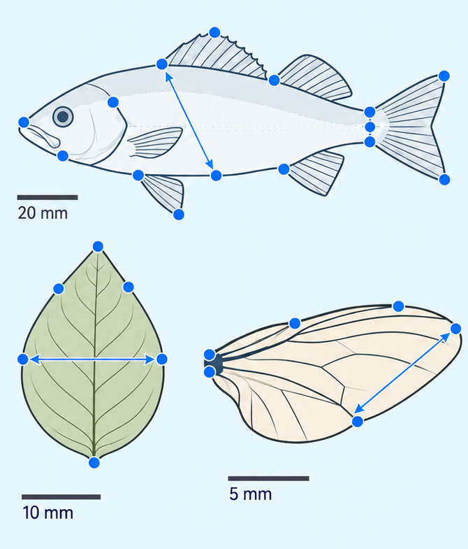
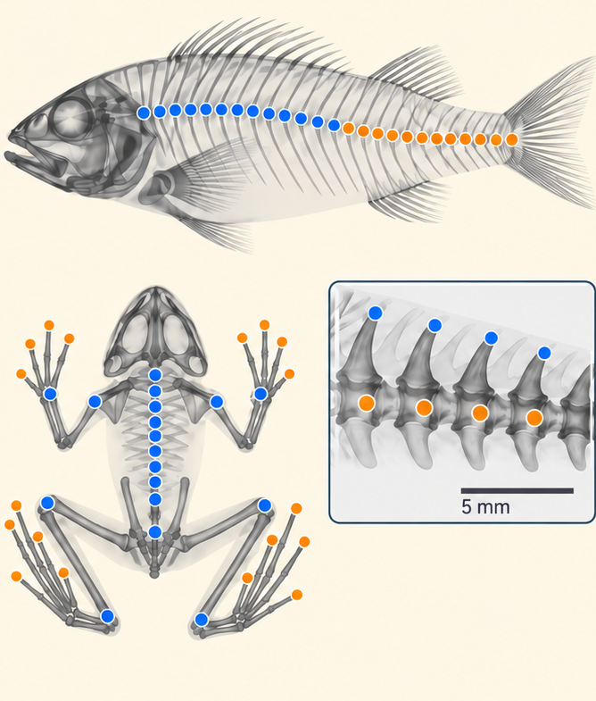

# MorphoLabel

**AI-powered, human-verified software for standardized, large-scale extraction of morphological data from biological images.**

MorphoLabel is built for researchers who need to process hundreds or thousands of photographs or radiographs using consistent anatomical definitions. The researcher annotates a representative set of specimens, **trains task-specific AI models**, and uses them to process the remaining images in batches. Predictions are reviewed and corrected, then converted into landmark coordinates, linear measurements or anatomical trait tables.

The software follows a **collection-wide scientific workflow**: prepare specimen images first, annotate the same structures across the collection next, and then inspect and export the data. Biological definitions, specimen identity, model provenance, human corrections and verification status remain attached to the project. Manual annotation is available, but **AI training and batch prediction are the principal means of scaling the workflow**.

**Current release:** [MorphoLabel 1.0.0-rc.1](https://github.com/olegartaev/MorphoLabel/releases/tag/v1.0.0-rc.1) · Windows 10/11 x64 · Apache-2.0

[Download installer](https://github.com/olegartaev/MorphoLabel/releases/download/v1.0.0-rc.1/MorphoLabel-1.0.0-rc.1-Setup-x64.exe) · [Full User Guide](docs/USER_GUIDE.md) · [Changelog](CHANGELOG.md) · [Citation](CITATION.cff)

---

## Why MorphoLabel

Biological imaging can produce material much faster than it can be measured. A major obstacle in comparative morphology is not only the time required to annotate each specimen, but also the need to apply **the same anatomical definitions and review criteria** throughout a large collection. Changes in framing, observer placement, image quality or trait interpretation can otherwise make datasets difficult to compare.

MorphoLabel addresses this with a reproducible sequence:

1. **Define the biological task.** Specify homologous landmarks, structures, reference marks or counting rules before mass annotation.
2. **Create reference annotations.** A researcher checks a diverse starting set; these become training examples, not unexamined labels.
3. **Automate the repetitive work.** Train separate AI models for image preparation and anatomical annotation, then run predictions on larger batches.
4. **Verify the scientific result.** Correct AI drafts, quantify human repeatability where appropriate and review suspicious observations.
5. **Export traceable data.** Retain the relationship between specimens, schemes, model predictions, corrections and calculated variables.

### Process one stage across many specimens

For a large collection, **complete or review the relevant Crops first**, then process the Landmarks or X-ray Structures stage across the prepared specimens. This minimizes repeated changes of task and keeps anatomical decisions consistent.

- **Landmarks & Measurements:** scheme → Crop across images (if needed) → AI-assisted landmark annotation and human review → linear measurements / shape-coordinate export.
- **X-ray Traits:** trait scheme → AI-assisted specimen Crops across radiographic plates → AI-assisted structure annotation and human review → calculated meristic traits / export.

Each stage can be worked through in successive batches, and individual specimens can be revisited. The sequence is a recommended workflow, not a requirement to finish every Crop in the project before making a landmark.

**The AI is the automation engine; the researcher remains responsible for biological validity.** A trained model learns how to reproduce the supplied annotations. It does not establish landmark homology, decide whether a rare trait is biologically real, or make every prediction reliable. The application can also be operated manually without installing AI components.

## Production modules

<table>
  <tr>
    <th width="50%" align="center"><strong>Landmarks &amp; Measurements</strong></th>
    <th width="50%" align="center"><strong>X-ray Traits</strong></th>
  </tr>
  <tr>
    <td width="50%" valign="top"></td>
    <td width="50%" valign="top"></td>
  </tr>
  <tr>
    <td valign="top">Automated landmark placement and measurement across photographic collections.</td>
    <td valign="top">Automated specimen detection and anatomical structure annotation across radiographic collections.</td>
  </tr>
</table>

### Landmarks & Measurements

**Scientific task.** Record the same anatomically defined 2D landmarks across large series of specimens, creating comparable coordinate datasets for geometric morphometrics and reproducibly defined linear distances for traditional morphometric analyses. Useful settings include comparative morphology, ontogenetic series, museum collections and population-level datasets.

**Automation.** Crop can first standardize how specimens are framed and oriented. A researcher defines the landmark scheme and checks representative images; a project-trained landmark model then proposes the corresponding points on other eligible images. Batch prediction and review queues shift effort from repeatedly placing every point to finding and correcting difficult or unusual cases.

**Scientific controls and outputs.** Landmark identity and order follow the project scheme; points that cannot be reliably identified can be marked missing rather than guessed. Two independent manual passes can quantify placement disagreement. Final QC helps locate suspicious configurations and measurements without treating biological outliers as automatic errors. Exports include TPS, wide/long CSV, MorphoJ-compatible coordinates, linear measurement tables and a reviewed analysis bundle with identity and omission information.

Linear measurements are derived from specified landmark pairs. Physical measurements in **millimetres** require a valid calibration; one calibration applies to a sample/locality group and must not be reused across images with different effective scales. MorphoLabel prepares data for geometric morphometrics but does not perform Generalized Procrustes Analysis or downstream shape statistics.

### X-ray Traits

**Scientific task.** Convert series of radiographs into specimen-level observations of repeated anatomical structures and the traits derived from them. In fish osteology, for example, a scheme may define vertebral or pterygiophore series, anatomical boundary markers and meristic counts for distinct body regions. The scheme controls which structures are annotated and how marks contribute to each trait; fish and vertebrae are examples, not hard-coded definitions of the calculation system.

**Automation.** A radiographic plate can contain several specimens. Crop AI proposes specimen frames and orientation, which are confirmed before structure analysis. A separately trained Structure AI model proposes repeated-element and reference-marker annotations on the prepared specimens. The researcher reviews the marks, corrects counts or reference roles and verifies the specimens. Trait values are calculated from the active scheme rather than entered independently for every specimen.

**Scientific controls and outputs.** The workflow distinguishes **Complete**, **Partial**, **Not visible** and **Absent**; missing evidence must not be converted into biological absence. Scheme-defined boundaries and inclusion rules determine meristic counts, while human repeatability and result review help identify inconsistencies. Results are exported as specimen-linked CSV trait tables, including a **Verified only** option.

The present orientation workflow is best suited to specimens for which head and ventral directions are meaningful. Numbering a repeated series follows its spatial arrangement and should be checked against anatomical order, particularly for curved or non-linear structures. Current X-ray distance values are relative to normalized Crop coordinates, **not physical lengths in millimetres**.

## Interface

These screenshots show example annotation workspaces. The appearance may vary slightly with display scaling.

### Landmarks & Measurements

*Landmark annotation workspace: specimen navigation, anatomical landmark scheme, human verification, AI prediction/review and final data QC.*

### X-ray Traits

*X-ray Structures workspace: repeated-element annotation, anatomical reference markers, human-reviewed AI output, prediction/review controls and result checking.*

## Typical workflow

A new project normally proceeds in this order:

1. **Build the project and define the anatomy.** Import the images, check specimen identities and specify the landmark or trait scheme.
2. **Prepare images in bulk.** Annotate a representative set of Crops, train the Crop model and use it on further images or plates. Confirm the proposed framing and orientation. Crop is optional for Landmarks images that already have suitable framing.
3. **Annotate structures in bulk.** Verify a representative set of landmarks or X-ray structures, train the relevant annotation model and predict the remaining eligible specimens in batches.
4. **Review and improve.** Correct AI predictions, preserve human-verified observations and, if needed, retrain with examples of recurring errors and underrepresented morphology.
5. **Calculate and inspect traits.** Define linear measurements or evaluate X-ray trait calculations, use Human Repeatability and final QC where relevant, and resolve suspicious cases.
6. **Export for analysis.** Select the appropriate verified subset, inspect missing values and retain specimen identity, scheme and model provenance.

**Within each stage, the cycle is reference annotations → train → batch prediction → review → improve.** Larger batches become practical only when the model performs adequately on representative material.

For button-by-button instructions, see the **[MorphoLabel User Guide](docs/USER_GUIDE.md)**.

## AI automation and human verification

MorphoLabel is designed to **automate the high-volume steps**, not to replace the scientist. It supports separate training and prediction workflows for Landmarks Crop, landmark placement, X-ray specimen Crop/orientation and X-ray Structures. These models learn from project-specific human reference examples; imported models can also be reused when their tasks and schemas are compatible.

After training, **Predict next batch** and **Predict all** apply a selected model to eligible records. Review tools keep unverified AI proposals distinct from annotations accepted by a person; ordinary batch prediction protects previously verified work. Models and their lineage can be inspected, selected, imported and exported.

Human Repeatability evaluates how consistently an observer repeats annotations. AI–human comparison and final QC provide additional checks, but **neither model agreement nor a Verified status establishes biological truth**. Landmark homology, counting boundaries, anatomical absence and unusual observations remain scientific judgments.

### AI installation and privacy

The Windows installer provides the main application. The guided **AI support** setup installs the larger components needed for training and prediction, checks hardware and supports resuming interrupted downloads. A compatible GPU is useful, with CPU fallback available. AI model training and prediction are performed locally; the AI setup process does not upload project images or scientific data.

Users can work manually if AI support is not installed, but **training and batch prediction are the intended route for large datasets**. External general-purpose AI assistants, accessible through **Menu → Help with an AI assistant…**, are for explaining the application; they are separate from MorphoLabel's image-processing models.

## Reproducibility support and data safety

MorphoLabel is built around persistent project state rather than one-off image editing.

Projects preserve, where applicable:

- references to source images and source hashes;
- Crop geometry and orientation;
- landmark or structure annotations;
- human-verification state;
- excluded-item state;
- model identity and prediction provenance;
- annotation and correction history;
- repeatability records;
- QC/review state;
- calibration and measurement definitions;
- software and workflow metadata used for export.

Original source images are not edited by normal annotation operations. X-ray projects can also be made self-contained by copying source radiographs into the project.

**Recommendation:** back up the complete MorphoLabel project folder together with any externally referenced source-image folders.

## Installation

MorphoLabel currently targets **Windows 10/11 x64**.

Most users only need the standalone installer:

**[MorphoLabel-1.0.0-rc.1-Setup-x64.exe](https://github.com/olegartaev/MorphoLabel/releases/download/v1.0.0-rc.1/MorphoLabel-1.0.0-rc.1-Setup-x64.exe)**

No separate Python or Git installation is required for normal use.

The optional AI components are downloaded by MorphoLabel when AI support is installed. The large AI release assets are not intended for manual installation.

## Outputs

Depending on the module and project configuration, MorphoLabel can produce:

- landmark coordinates in TPS;
- landmark coordinates in wide or long CSV;
- MorphoJ-compatible coordinate text;
- calibrated linear measurements in CSV or tab-delimited text;
- a **Verified only** analysis dataset bundle (by default) with specimen identities, landmark and measurement tables, definitions and missing-value/omission reports;
- X-ray trait tables in CSV;
- verified-only X-ray trait exports;
- portable trained-model packages;
- diagnostic ZIP reports for technical support.

**Export note:** for Landmarks & Measurements, use **Export analysis dataset… → Verified only (default)** to prepare a reviewed analysis bundle; direct TPS/CSV/MorphoJ and measurement exports may include eligible unverified records. In X-ray Traits, the trait-table exporter also offers **Verified only**. Verification records human review, not proof of biological validity.

## Intended use

MorphoLabel is intended for researchers building large, consistently annotated morphology-from-image datasets, including:

- geometric morphometrics;
- linear morphometrics derived from landmarks;
- skeletal counts and meristic traits;
- radiographic datasets;
- museum and field image collections;
- taxonomic and comparative morphology;
- projects where annotation consistency and auditability are important.

The software standardizes the **annotation procedure within a defined project**; it cannot automatically remove variation introduced by different cameras, image scales, specimen positioning or observers. The researcher remains responsible for establishing anatomical homology, selecting a suitable sampling design, checking calibration and interpreting the data.

For geometric morphometrics, MorphoLabel prepares landmark-coordinate data; it does not replace downstream procedures such as Generalized Procrustes Analysis, shape statistics or biological interpretation in software such as MorphoJ, R or other analytical environments.

## Release status

**1.0.0-rc.1 is the first public release candidate of MorphoLabel.** It includes Landmarks & Measurements and X-ray Traits in one Windows application, with human-verified workflows and traceable scientific exports. This candidate is available for external evaluation ahead of stable 1.0.0.

For routine usage questions, open **Menu → Help with an AI assistant…** to copy a question template referencing the public User Guide and source code. Paste it into an external AI assistant of your choice; verify scientific advice and do not share confidential research data.

If you encounter a reproducible technical problem, use **Menu → Create diagnostic report…**. The diagnostic ZIP is designed not to include research photographs or the project SQLite database.

For newer builds and current release notes, visit the [Releases page](https://github.com/olegartaev/MorphoLabel/releases).

## Documentation

- **[Full User Guide](docs/USER_GUIDE.md)** — installation, concepts, complete workflows, AI, QC, export and troubleshooting.
- [Changelog](CHANGELOG.md) — release history.
- [Contributing](CONTRIBUTING.md) — source-development guidance.
- [Extension architecture](docs/EXTENSIONS.md) — module-extension design.
- [Security](SECURITY.md) — security reporting.

## Citation

Citation metadata are provided in [CITATION.cff](CITATION.cff).

When MorphoLabel or a model substantially based on it contributes to published research, please identify MorphoLabel as the software source and cite the version used.

## License

MorphoLabel is released under the [Apache License 2.0](LICENSE). See [NOTICE](NOTICE) for attribution information.

## Contact

Scientific or software questions: **morpholabel@olegartaev.com**
